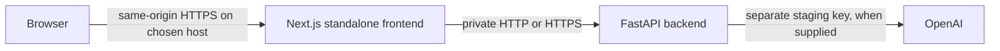

# Launch readiness audit and staging milestone

Audited 22 October 2026. This is an engineering readiness audit, not confirmation of commercial, legal or security readiness.

## Steps 1–3

1. Reviewed Task 3 PRs are merged: frontend main `a594807e98e71f9cfc55ea3494c4fdc89f65c6e3`, backend main `0045ce66996099ee3dd07b0bb76d8292fc3357d9`. Both PR CI runs passed before merge.
2. Source/runtime audit completed. Staging changes are isolated on `dev/staging-readiness` in each repository.
3. Portable staging containers, health checks, runtime configuration, smoke checks and rollback instructions are prepared. A managed, externally reachable staging deployment requires a connected hosting account and has not been completed. The Codex-local stack is not durable external hosting or a shareable preview.

## Architecture prepared

The browser no longer calls its own localhost to find the server. `RAMS_API_URL` is server-only runtime configuration. The backend is not published on a host port in Compose; the frontend defaults to `127.0.0.1:8080`. Both containers run as non-root users, base images are pinned by digest, runtime secrets are excluded from image build contexts and model calls are not required for liveness/PDF checks. Build/runtime CA mounts preserve managed proxy TLS verification.

Liveness, configuration readiness, correlation IDs and request timing are available. Readiness means configuration is present, not that a live OpenAI request has succeeded. Blocking extraction/model/PDF work runs in FastAPI's thread pool so health probes can remain responsive. CI validates each image's build/startup; cross-service smoke checks are supplied in the backend repository.

## Findings and priorities

| Priority | Finding | Disposition |
|---|---|---|
| Staging | Hard-coded browser API addresses; local-only CORS | Same-origin proxy and explicit backend CORS configuration prepared |
| Staging | Import-time key requirement prevented credential-free startup | Lazy client construction; liveness/PDF available without a key; model operations return 503 |
| Staging | No deployable image, version check or health path | Non-root images, version labels, health endpoints, smoke checker and runbook prepared |
| Staging | Blocking functions called directly in async handlers | Thread-pool execution and responsiveness regression added |
| External staging | No hosting destination, account binding, HTTPS ingress or provider access confirmed | Render integration found and suggested; connection and exact plan/cost/access-control review remain outstanding |
| External staging | No separately configured staging OpenAI key | Supply securely only when live-model validation is authorised; not needed for configuration/PDF smoke tests |
| Before real-user pilot | Submissions/history exist only in browser localStorage | Choose durable server storage, retention/deletion and backup/recovery design in the multi-user stage |
| Before real-user pilot | No application authentication or organisation isolation found | Implement and test the agreed multi-user access model; use controlled staging ingress beforehand |
| Before real-user pilot | No upload-size/rate/cost limits found in inspected request paths | Agree and implement limits; restrict staging to authorised testers and synthetic data until controls are established |
| Before real-user pilot | Header date is fixed at 20 May 2026; Site Specificity is 68%/45% and Generic Content uses 32%/Low heuristics | Product decision needed: replace with measured, evidenced values or remove/clearly label them; these are not validated quality measures |
| Before real-user pilot | Live model structured-output acceptance/quality, OCR on representative scans, latency and cost unvalidated | Execute the representative-document stage with reviewer acceptance criteria |
| Before production | No operational alerts, support process or provider rollback drill confirmed | Connect hosting/monitoring, assign ownership, rehearse on the actual platform and approve go/no-go |
| Before production | No comprehensive dependency/vulnerability, privacy/terms or data-handling review completed | Schedule these launch gates separately; passing functional CI is not security/commercial approval |

Initial scoring, reassessment penalties, category ratings and review outcomes are not changed by the staging-readiness work. Supabase packages are installed, but no durable submission implementation was found in the inspected application paths. The default Next.js README's Vercel text was template guidance, not evidence of an existing deployment.

## Validation evidence

Local verification passed:

| Check | Observed result |
|---|---|
| Frontend TypeScript, lint and production build | Passed; 0 lint errors / 7 existing warnings |
| Standalone browser/runtime regressions | 18 passed |
| Backend offline regressions | 29 passed |
| Both container builds and isolated startup | Passed after correcting file permissions |
| Private frontend-to-API health and real PDF smoke | Passed without an OpenAI key; readiness correctly 503 |
| OCR engine inside non-root API image | Synthetic OCR passed as UID 10001 |
| Deliberately broken frontend upstream configuration | Smoke check failed as expected; previous configuration restored and smoke passed |
| Connected browser/proxy/FastAPI review and reassessment | Passed with OpenAI mocked; current API/storage/PDF 96%, preserved original 82% |

GitHub clean-runner results and exact candidate commit versions are recorded in the PRs. A failing non-root backend container startup exposed source file mode 0600; Docker now copies application code as read-only/readable to the runtime user. No production service, domain, credentials or infrastructure was modified. No live model requests or third-party hosting purchases were made.

The checked-out repositories and container stack are in the development environment. They must not be described as an externally accessible staging service. External staging remains blocked until an appropriate host is connected and access controls, region, plan/cost and secret bindings are reviewed.

## Next actions after hosting connection

Inspect the account first, select a separate staging project/region and a concrete plan within the approved budget, and verify provider support for private backend networking and restricted frontend access. Configure paired frontend/backend commit versions and separate staging secrets, deploy the two images together, run the smoke checker against the actual HTTPS staging origin, configure monitoring/alerts and perform the provider rollback rehearsal. Only then mark external staging complete.
